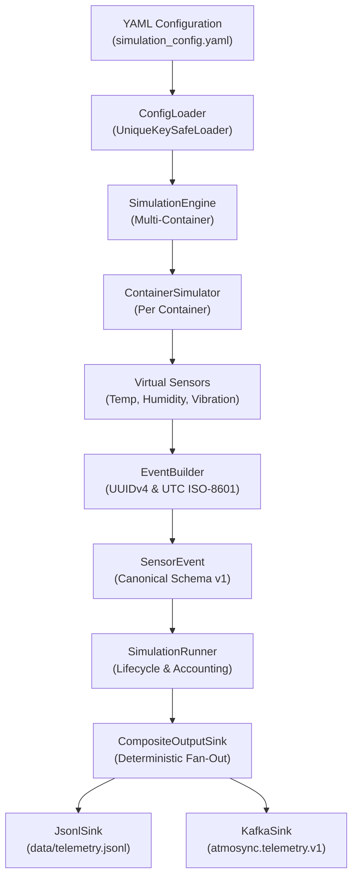

# AtmoSync — Micro-Climate Arbitrage Analytics
## Task A: IoT Sensor Simulator, Event Engineering, Unified Runner, and Kafka Producer

**Repository:** `Infotact_Data_Analyst_internship`  
**Branch:** `feature/siddarth-simulation-event-engineering`  
**Owner:** Siddarth (Lead Data Engineer — Task A)  
**Status:** Implementation Complete & Operationally Verified  

---

## 1. Project Overview

**AtmoSync** is an end-to-end data platform engineered to analyze micro-climate environmental conditions inside intermodal refrigerated shipping containers (*reefers*) transporting high-value agricultural commodities (e.g. berries, avocados, pharmaceuticals). By tracking micro-climatic variances across transit routes, the system identifies quality degradation risks and arbitrage opportunities.

This repository contains the implementation and documentation of **Task A**, the foundational upstream telemetry simulation and real-time streaming pipeline.

### Task A Responsibility
Task A provides a deterministic, high-throughput IoT sensor simulation engine that generates multi-modal container telemetry, validates payloads against a strict canonical contract, serializes events deterministically, and publishes them concurrently to local file storage and Apache Kafka topics.

```text
+---------------------------------------------------------------------------------------------------+
|                                       ATMOSYNC PLATFORM                                           |
|                                                                                                   |
|  [ TASK A ] (Implemented in this Repository)    [ TASK B ]              [ TASK C ]   [ TASK D ]   |
|  +-----------------------------------------+    +---------------+       +----------+ +----------+ |
|  | - IoT Virtual Sensor Simulation         |    | - Snowflake   |       | - dbt    | | - Apache | |
|  | - Container Fleet Coordination          |    |   Raw Staging |       |   Silver | |   Super- | |
|  | - Canonical Version-1 Event Contract    | => |   Tables      | ====> |   & Gold | |   set    | |
|  | - Unified Multi-Sink Runner & CLI       |    | - Ingestion   |       |   Models | |   Dash-  | |
|  | - Idempotent Apache Kafka Producer      |    |   Pipes       |       |          | |   boards | |
|  +-----------------------------------------+    +---------------+       +----------+ +----------+ |
+---------------------------------------------------------------------------------------------------+
```

> [!NOTE]
> **Scope Notice:** This repository implements **Task A only**. Downstream data warehouse ingestion into Snowflake (Task B), dbt analytical transformations (Task C), and Apache Superset business intelligence dashboards (Task D) represent separate project components.

---

## 2. Key Features

- **Multi-Modal Virtual Sensors:** Independent statistical models for ambient temperature (Gaussian), relative humidity (bounded Gaussian), and vibration magnitude (Rayleigh distribution).
- **PRNG Stream Isolation:** Deterministic pseudo-random number generation using cryptographically stable SHA-256 seed derivation, eliminating platform hash randomization variance across processes.
- **Container Fleet Simulation:** Coordinates virtual sensor clusters across multiple shipping containers (`CONTAINER_001`, `CONTAINER_002`, `CONTAINER_003`).
- **Option A Event Multiplicity:** Emits one top-level, independent event per sensor reading, enabling decoupled schema evolution and granular routing.
- **Strict Canonical Data Contract:** Enforces a rigid 7-field schema Version 1 (`SensorEvent`) with millisecond UTC ISO-8601 timestamps ending in `'Z'`, UUIDv4 surrogate keys, and non-finite number rejection.
- **Deterministic JSON Serialization:** Guarantees strict canonical field ordering and compact separators for byte-level determinism.
- **Dual-Destination Architecture:** Pluggable output sink abstraction (`OutputSink`) supporting append-only JSON Lines (`JsonlSink`), streaming (`KafkaSink`), and parallel fan-out (`CompositeOutputSink`).
- **Idempotent Kafka Streaming:** Powered by `confluent-kafka` (librdkafka C-engine) with partition affinity keyed by `container_id`, `acks="all"`, and `enable.idempotence=True`.
- **Unified Pipeline Orchestrator:** `SimulationRunner` manages execution lifecycles, enforces fail-fast error boundaries, preserves in-flight exceptions, and coordinates clean shutdowns.
- **Delivery Accounting & Metrics:** Accurately distinguishes between local client memory enqueue (`attempted`) and broker partition persistence (`delivered`).
- **Operational CLI & Signal Handling:** Command-line interface with non-blocking graceful shutdown across `SIGINT` (Ctrl+C), `SIGTERM`, and Windows `SIGBREAK`.

---

## 3. Architecture Overview

The diagram below represents the implemented data generation and streaming flow:



For the complete architectural specification, component lifecycles, and class hierarchies, refer to [docs/ARCHITECTURE.md](docs/ARCHITECTURE.md).

---

## 4. Technology Stack

Task A is built exclusively using production-grade open-source technologies:

| Layer / Subsystem | Technology | Version | Purpose |
| :--- | :--- | :---: | :--- |
| **Language Runtime** | Python (CPython) | `3.10+` (verified on `3.13.14`) | Core simulation engine, event building, and CLI execution. |
| **Configuration** | PyYAML | `>=6.0.1` | Declarative YAML loading with custom duplicate-key detection. |
| **Streaming Client** | confluent-kafka | `>=2.0.0` (librdkafka 2.16.1) | High-performance C-based asynchronous Kafka producer. |
| **Streaming Broker** | Apache Kafka (KRaft) | `7.6.0` (`confluentinc/cp-kafka`) | Single-node ZooKeeper-less development message broker. |
| **Container Engine** | Docker Compose | `v2.20+` | Containerized Kafka KRaft broker deployment. |
| **Testing & Coverage**| pytest & pytest-cov | `pytest>=8.0.0`, `cov>=4.1.0` | Comprehensive unit, failure, and live integration test suites. |

---

## 5. Repository Structure

```text
Infotact_Data_Analyst_internship/
├── docker-compose.kafka.yml          # Single-node KRaft Kafka broker configuration
├── requirements.txt                  # Core production runtime dependencies
├── requirements-dev.txt              # Development, testing, and coverage dependencies
├── pytest.ini                        # Test runner configuration and custom markers
├── LICENSE                           # MIT License
├── README.md                         # This primary documentation entrypoint
├── data/                             # Runtime persistence directory
│   ├── .gitkeep                      # Preserves directory in version control
│   └── verification/                 # [Untracked] Local integration test artifacts
├── docs/                             # Authoritative technical documentation suite
│   ├── DATA_CONTRACT.md              # Telemetry schema, types, and validation rules
│   ├── ARCHITECTURE.md               # System architecture and component manual
│   ├── OPERATIONS_GUIDE.md           # Operational runbook, setup, and troubleshooting
│   ├── VERIFICATION_REPORT.md        # Comprehensive test audit and QA ledger
│   ├── STAGE_5_KAFKA_DESIGN.md       # Historical Kafka producer design
│   ├── STAGE_6_2_RUNNER_DESIGN.md    # Historical simulation runner design
│   └── STAGE_6_3_CLI_GUIDE.md        # Historical CLI operational guide
├── simulation/                       # Task A Python implementation package
│   ├── __init__.py                   # Package exports & version (__version__ = "0.1.0")
│   ├── __main__.py                   # Package executable entrypoint
│   ├── cli.py                        # CLI argument parsing, SignalContext & exit codes
│   ├── runner.py                     # SimulationRunner orchestrator & RunnerMetrics
│   ├── config/                       # YAML parsing, validation & AppConfig dataclass
│   ├── events/                       # Canonical SensorEvent, EventBuilder, EventSerializer
│   ├── kafka/                        # KafkaProducer, KafkaConfig, delivery callbacks & stats
│   ├── output/                       # OutputSink contracts, JsonlSink, CompositeOutputSink
│   ├── sensors/                      # BaseSensor, Temperature, Humidity, Vibration models
│   ├── simulator/                    # ContainerSimulator and SimulationEngine loops
│   └── validation/                   # EventValidator strict contract checking
└── tests/                            # Automated test suite (377 items across 21 files)
```

---

## 6. Prerequisites

- **Python:** Python 3.10+ (64-bit AMD64). Tested and verified on **Python 3.13.14**.
- **Docker (Optional for local testing; Required for Kafka):**
  - **JSONL-Only Mode:** Does **not** require Docker or Kafka. You can run simulations and test suites immediately with Python alone.
  - **Kafka / Dual-Sink Mode:** Requires Docker Desktop (Windows / macOS) or Docker Engine (Linux) to run `docker-compose.kafka.yml`.
- **Ports:** Port `9092` must be available on the host machine for Kafka streaming.

For complete operating system instructions, see [docs/OPERATIONS_GUIDE.md](docs/OPERATIONS_GUIDE.md).

---

## 7. Quick Start (Windows PowerShell)

### Step 1: Environment Setup
```powershell
# 1. Clone repository and navigate to root
git clone https://github.com/RohanVipin/Infotact_Data_Analyst_internship.git
cd Infotact_Data_Analyst_internship

# 2. Check out feature branch
git checkout feature/siddarth-simulation-event-engineering

# 3. Create and activate virtual environment
py -3.13 -m venv .venv
.\.venv\Scripts\Activate.ps1

# 4. Install dependencies
pip install -r requirements.txt
pip install -r requirements-dev.txt
```

### Step 2: Run CLI Help & Version
```powershell
python -m simulation --help
python -m simulation --version
```

### Step 3: Fast Track — Local Simulation (No Docker / 30-Second Run)
Run 5 simulation cycles persisting exclusively to local disk (`data/telemetry.jsonl`):
```powershell
python -m simulation -n 5 -m jsonl
```
Inspect the generated records:
```powershell
Get-Content data/telemetry.jsonl -Tail 5
```

### Step 4: Full Pipeline — Live Kafka Streaming
Start the local KRaft Kafka broker:
```powershell
docker compose -f docker-compose.kafka.yml up -d
```

Execute a 10-cycle dual-sink simulation (emits 90 events simultaneously to disk and Kafka):
```powershell
python -m simulation -n 10 -m both
```

Stop the Kafka broker when finished:
```powershell
docker compose -f docker-compose.kafka.yml down
```

---

## 8. Configuration

Simulation parameters are declared in `simulation/config/simulation_config.yaml`:

```yaml
simulation:
  interval_seconds: 1.0       # Delay between cycles in seconds
  random_seed: null           # Integer seed for deterministic runs, or null

containers:
  - "CONTAINER_001"
  - "CONTAINER_002"
  - "CONTAINER_003"

sensors:
  temperature:
    enabled: true
    unit: "celsius"           # Provisional unit
    min_value: null           # Unconstrained baseline
    max_value: null
  humidity:
    enabled: true
    unit: "percent"           # Provisional unit (% RH)
    min_value: null
    max_value: null
  vibration:
    enabled: true
    unit: "m/s^2"             # Provisional unit
    min_value: null
    max_value: null
```

- **Custom Configuration:** Supply an alternative YAML file via `-c` / `--config`:
  ```powershell
  python -m simulation -c path/to/custom_config.yaml -n 5
  ```
- **Provisional Defaults Notice:** Measurement units (`celsius`, `percent`, `m/s^2`) and statistical baseline parameters are provisional demonstration defaults for software verification, not approved cargo preservation standards.

---

## 9. Data Contract Summary

Every reading emitted by Task A adheres strictly to the canonical **Version-1 7-field schema**:

| Field Name | Type | Constraints | Description |
| :--- | :---: | :--- | :--- |
| `schema_version` | `int` | Strictly integer `1`. | Payload schema version. |
| `event_id` | `str` | Canonical UUIDv4 string (36 chars, lowercase). | Globally unique reading identifier. |
| `container_id` | `str` | Non-empty container string (e.g. `"CONTAINER_001"`). | Shipping container entity identifier. |
| `sensor_type` | `str` | Enum: `{"temperature", "humidity", "vibration"}`. | Sensor modality. |
| `observed_at` | `str` | UTC ISO-8601 with millisecond precision ending in `'Z'`. | Physical observation timestamp. |
| `value` | `float`| Finite numeric float. Booleans, `NaN`, `Inf` rejected. | Quantitative measurement. |
| `unit` | `str` | Non-empty string matching configuration. | Unit of measurement. |

### Canonical Event Example
```json
{
  "schema_version": 1,
  "event_id": "e595301f-e4ac-4315-ace4-cf54731cb674",
  "container_id": "CONTAINER_001",
  "sensor_type": "temperature",
  "observed_at": "2026-11-06T06:13:01.949Z",
  "value": 5.07,
  "unit": "celsius"
}
```

For the complete schema contract, validation error matrix, and consumer guidelines, see [docs/DATA_CONTRACT.md](docs/DATA_CONTRACT.md).

---

## 10. Running Tests & Historical QA Audit

### Executing Automated Tests
```powershell
# Run all unit and local integration tests (does not require Kafka)
pytest -v

# Run with statement coverage report
pytest --cov=simulation --cov-report=term-missing

# Run live Kafka integration tests (requires Docker Kafka running)
pytest -v -m integration
```

### Verified Historical Test Results
- **Phase D1 Read-Only Audit Execution:**
  - **377 test cases collected** across 21 test files.
  - **373 tests passed** in ~12 seconds.
  - **4 live integration tests skipped** gracefully when Kafka was offline.
  - **91% statement coverage** across the `simulation` package.
- **Historical Live Kafka Remediation Audit:**
  - 18/18 events published and acknowledged by Kafka broker (`localhost:9092`).
  - Independent consumer verified 100% bit-for-bit parity with JSONL records.
  - Offline broker injection verified `PARTIAL_FAILURE` and exit code 1.
  - Signal interruption verified graceful shutdown with exit code 130.

> [!NOTE]
> The figures above represent historical audit results recorded during prior test executions. Running `pytest -v` locally reproduces the 373 passed unit tests.

For the full QA ledger, failure injection analysis, and evidence inventory, see [docs/VERIFICATION_REPORT.md](docs/VERIFICATION_REPORT.md).

---

## 11. Authoritative Documentation Index

| Document | Description & Primary Audience |
| :--- | :--- |
| **[docs/DATA_CONTRACT.md](docs/DATA_CONTRACT.md)** | Authoritative 7-field schema specification, validation rules, Kafka keying, and downstream ingestion guidance (Tasks B, C, D). |
| **[docs/ARCHITECTURE.md](docs/ARCHITECTURE.md)** | Deep technical architecture, package hierarchy, PRNG seed isolation, multi-sink fan-out, and runner lifecycle state machines. |
| **[docs/OPERATIONS_GUIDE.md](docs/OPERATIONS_GUIDE.md)** | Administrator runbook, environment setup, KRaft Docker setup, CLI manual, and practical troubleshooting matrix. |
| **[docs/VERIFICATION_REPORT.md](docs/VERIFICATION_REPORT.md)** | Evidence-based technical audit report, test breakdown, code coverage ledger, and failure remediation history. |
| **[docs/STAGE_5_KAFKA_DESIGN.md](docs/STAGE_5_KAFKA_DESIGN.md)** | Historical Stage 5 Kafka producer architecture and design specification. |
| **[docs/STAGE_6_2_RUNNER_DESIGN.md](docs/STAGE_6_2_RUNNER_DESIGN.md)** | Historical Stage 6.2 simulation runner design specification. |
| **[docs/STAGE_6_3_CLI_GUIDE.md](docs/STAGE_6_3_CLI_GUIDE.md)** | Historical Stage 6.3 command-line interface guide. |

---

## 12. Scope and Operational Limitations

1. **Task A Boundary:** Task A is responsible for sensor telemetry simulation, canonical validation, and streaming into Kafka topic `atmosync.telemetry.v1`. Downstream Snowflake storage, dbt modeling, and Superset dashboards belong to Tasks B, C, and D.
2. **Development-Grade Broker:** The local KRaft container provides single-node development capabilities. It does not provide multi-broker replication or cross-datacenter failover.
3. **Non-Transactional Fan-Out:** `CompositeOutputSink` coordinates ordered dispatch to local files and Kafka without a distributed two-phase commit (2PC). If the broker is unreachable, local disk writes may succeed while Kafka publishes fail.
4. **Transport Idempotence Scope:** Kafka producer idempotence guarantees in-order, deduplicated writes **between the Python client and the broker log**. It does not provide end-to-end database exactly-once processing (EOS) into Snowflake.
5. **Synthetic Physical Models:** Virtual sensors generate synthetic statistical signals (Gaussian, Rayleigh) rather than empirical hardware telemetry. Container thermodynamics and reefer compressor duty cycles are not modeled.

---

## 13. Project Status

- **Task A Status:** Completed, fully tested (373 passed unit tests, 91% coverage), and documented across four comprehensive technical guides.
- **Git Baseline:** Synced on branch `feature/siddarth-simulation-event-engineering` at commit `f67f9853ddf9a0892449ddcf2184630099c89284`.
- **Downstream Readiness:** The canonical Version-1 event schema and Kafka topic `atmosync.telemetry.v1` are stable and ready for Task B ingestion handoff.

---

## 14. License

This project is licensed under the MIT License — see the [LICENSE](LICENSE) file for details.

