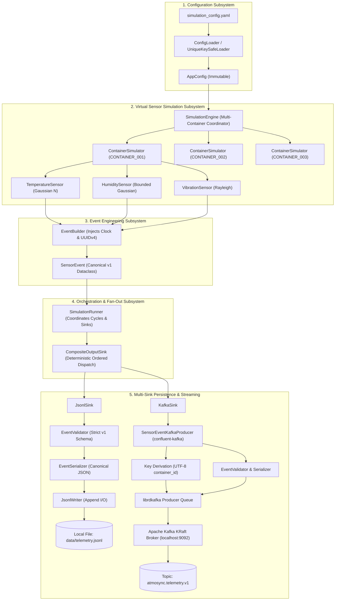
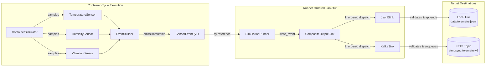
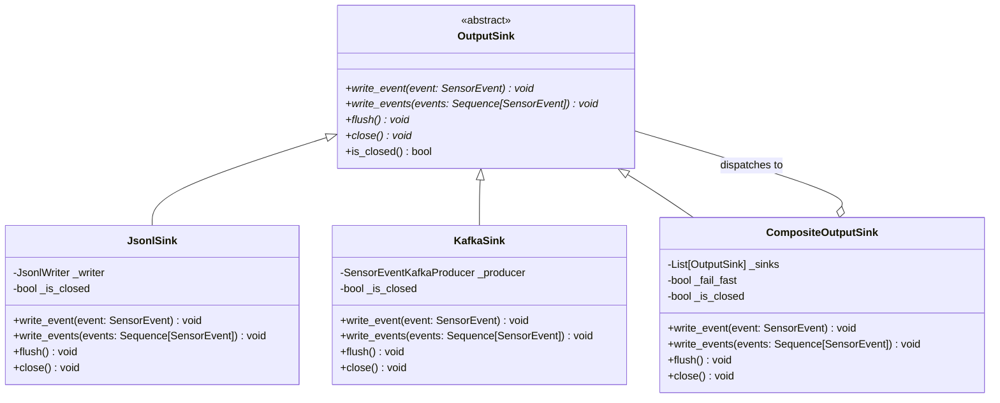
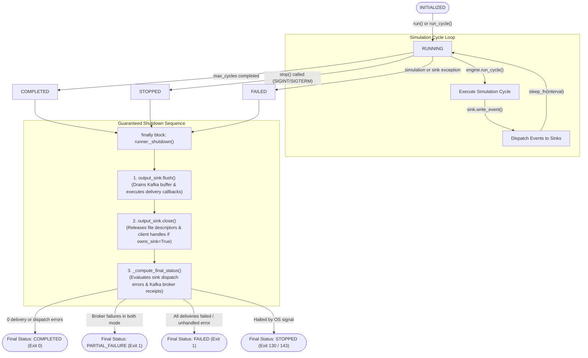

# AtmoSync Task A: Complete System Architecture Specification
**Document Version:** 1.0.0  
**Status:** Approved Technical Architecture  
**Scope:** Task A — IoT Sensor Simulator, Event Engineering, Unified Runner, and Kafka Producer  
**System:** AtmoSync — Micro-Climate Arbitrage Analytics  
**Target Repository:** `Infotact_Data_Analyst_internship`  
**Author:** Siddarth (Lead Data Engineer — Task A)  

---

## 1. Architecture Overview

### 1.1 Purpose & Mission
AtmoSync is a micro-climate arbitrage analytics platform designed to monitor environmental conditions for high-value agricultural commodities transported inside intermodal refrigerated shipping containers (reefers). 

**Task A** constitutes the foundational upstream telemetry generation and ingestion layer. Its responsibility is to provide a reliable, high-throughput, deterministic IoT sensor simulation and streaming pipeline that emits canonical container telemetry simultaneously to local storage and Apache Kafka topics feeding downstream data platform components.

```text
+---------------------------------------------------------------------------------------------------+
|                                       ATMOSYNC PLATFORM                                           |
|                                                                                                   |
|  [ TASK A ] (Active Scope)              [ TASK B ]              [ TASK C ]          [ TASK D ]    |
|  +---------------------------+          +---------------+       +---------------+   +----------+  |
|  | - IoT Virtual Sensors     |          | - Snowflake   |       | - dbt Core    |   | - Apache |  |
|  | - Container Simulation    | =======> |   Raw Tables  | ====> |   Silver/Gold | =>|   Superset| |
|  | - Canonical Event Schema  |  Stream  | - Ingestion   |       |   Models      |   |   Dash-  |  |
|  | - Unified Runner & CLI    |          |   Pipes       |       | - Analytics   |   |   boards |  |
|  | - Confluent Kafka Sink    |          +---------------+       +---------------+   +----------+  |
|  +---------------------------+                                                                    |
+---------------------------------------------------------------------------------------------------+
```

### 1.2 Core Architectural Principles
1. **Decoupled Modality via Option A Multiplicity:** Rather than bundling multi-sensor readings into monolithic container records, Task A emits one top-level, independent event per sensor reading. This guarantees that new sensor modalities can be introduced without modifying database schemas or breaking existing consumers.
2. **Strict Immutability & Single Event Identity:** Once an event is created by `EventBuilder`, it is encapsulated as a frozen dataclass (`SensorEvent`). When operating in dual-sink mode, the exact same in-memory object reference is passed to both destinations. No re-sampling, re-timestamping, or UUID regeneration occurs across destinations.
3. **Deterministic & Isolated PRNG Streams:** To ensure cross-process test repeatability and eliminate platform hash randomization (`PYTHONHASHSEED`), virtual sensors use independent pseudo-random number generator instances initialized via cryptographically stable SHA-256 seed derivation.
4. **Honest Metric Accounting:** The pipeline explicitly decouples synchronous client dispatch (acceptance into local memory buffers) from asynchronous broker delivery receipts (acknowledged writes committed to Kafka partition logs).
5. **Fail-Fast Error Policy with Guaranteed Cleanup:** In the event of simulation errors, file permission failures, or broker disconnections, the pipeline halts immediately (`fail_fast=True`), performs clean buffer flushing, releases operating system resources, and returns predictable POSIX exit codes.

---

## 2. High-Level Architecture Diagram

The flowchart below visualizes the end-to-end data processing pipeline from YAML configuration to downstream storage and streaming targets:



---

## 3. Repository Package Architecture

The codebase is organized into cleanly separated, single-responsibility Python packages under `simulation/`:

| Package Path | Module / Layer | Primary Architectural Responsibility |
| :--- | :--- | :--- |
| `simulation/config/` | Configuration | Loads, parses, and semantically validates YAML simulation settings into immutable dataclasses with duplicate-key detection. |
| `simulation/sensors/` | Virtual Sensors | Implements statistical simulation models (`BaseSensor`, Gaussian temperature/humidity, Rayleigh vibration) with SHA-256 PRNG stream isolation. |
| `simulation/simulator/` | Container Simulation | Manages virtual sensor clusters attached to specific shipping containers (`ContainerSimulator`) and multi-container cycle loops (`SimulationEngine`). |
| `simulation/events/` | Event Engineering | Defines the canonical 7-field schema (`SensorEvent`), event builder (`EventBuilder`), and deterministic JSON serialization (`EventSerializer`). |
| `simulation/validation/`| Schema Validation | Enforces strict Version-1 data contract invariants (`EventValidator`), rejecting malformed UUIDs, non-UTC timestamps, and non-finite numbers. |
| `simulation/output/` | Output Sinks | Implements the destination abstraction (`OutputSink`), file persistence (`JsonlSink`), streaming adapter (`KafkaSink`), and fan-out coordinator (`CompositeOutputSink`). |
| `simulation/kafka/` | Kafka Streaming | Encapsulates Kafka client interactions (`confluent-kafka`), configuration, error hierarchies, delivery callbacks, and thread-safe publishing metrics. |
| `simulation/runner.py` | Pipeline Runner | Top-level execution orchestrator (`SimulationRunner`) coordinating cycles, sink dispatches, metric collection, and post-shutdown status evaluation. |
| `simulation/cli.py` | Operational CLI | Command-line interface, argument parsing, OS signal registration (`SignalContext`), sink instantiation, and POSIX exit code mappings. |
| `simulation/__main__.py`| Executable Entrypoint| Package invocation entrypoint allowing terminal execution via `python -m simulation`. |

---

## 4. Configuration Architecture

### 4.1 Configuration Pipeline
Application configuration is driven by declarative YAML definitions loaded at startup. The configuration subsystem guarantees that execution never begins with invalid, missing, or malformed parameters:

```text
simulation_config.yaml
         |
         v (UniqueKeySafeLoader: Detects duplicate mapping keys)
Raw Dictionary Tree
         |
         v (ConfigLoader: Structural & Semantic Validation)
+--------+-------------------------------------------------------+
| AppConfig (Immutable Root)                                     |
|  ├── simulation: SimulationSettings (interval_seconds, seed)   |
|  ├── containers: Tuple[str, ...] ('CONTAINER_001', ...)        |
|  └── sensors: MappingProxyType[str, SensorConfig]              |
|        ├── temperature: SensorConfig(enabled, unit, limits)    |
|        ├── humidity:    SensorConfig(enabled, unit, limits)    |
|        └── vibration:   SensorConfig(enabled, unit, limits)    |
+----------------------------------------------------------------+
```

### 4.2 Structural and Semantic Validation Rules
- **Unique Mapping Keys:** `UniqueKeySafeLoader` (subclassing `yaml.SafeLoader`) overrides `construct_mapping()` to detect duplicate keys in YAML mappings at parse time, preventing configuration overwrites.
- **Top-Level Sections:** Enforces the mandatory presence of `simulation`, `containers`, and `sensors`.
- **Interval Validation:** `simulation.interval_seconds` must be a positive finite float ($> 0.0$).
- **Container IDs:** Must be a non-empty list of unique, non-blank strings. Duplicate container IDs raise `ConfigurationError`.
- **Sensor Definitions:** Mandates configuration for `temperature`, `humidity`, and `vibration`. Each sensor must specify a boolean `enabled` flag and non-empty `unit` string.
- **Limit Validation:** If `min_value` and `max_value` are specified, they must be finite numbers, and `min_value` must be strictly less than `max_value`.
- **Immutability:** Returns an `AppConfig` instance composed of frozen dataclasses and read-only `MappingProxyType` dictionaries, preventing runtime state mutation.

---

## 5. Virtual Sensor Architecture

Virtual sensors simulate realistic environmental telemetry using independent statistical distributions.

### 5.1 Base Sensor Abstraction (`BaseSensor`)
All virtual sensors derive from the abstract base class `BaseSensor`:
- **PRNG Stream Isolation:** Each sensor maintains an independent `random.Random` instance. When a master seed is provided, seeds are derived using SHA-256:
  $$\text{Seed}_{\text{sensor}} = \text{uint64}(\text{SHA-256}(\text{master\_seed} : \text{sensor\_name})[:8])$$
  This guarantees that sampling one sensor does not advance the PRNG stream of another sensor, eliminating platform hash randomization variance (`PYTHONHASHSEED`).
- **Effective Bounds & Rejection Sampling:**
  Effective limits are derived dynamically as:
  $$\text{eff\_min} = \max(\text{physical\_min}, \text{config\_min})$$
  $$\text{eff\_max} = \min(\text{physical\_max}, \text{config\_max})$$
  The sensor samples raw values up to 100 times (`max_sampling_attempts`). Any draw outside effective bounds is discarded. The accepted sample is rounded to the modality's configured precision and re-checked against effective bounds before returning.

### 5.2 Sensor Modality Implementations

| Modality Class | Distribution Model | Parameters & Defaults | Physical Bounds | Rounding Precision | Configured Unit |
| :--- | :--- | :--- | :---: | :---: | :---: |
| `TemperatureSensor` | Gaussian $N(\mu, \sigma^2)$ | Baseline Mean $\mu = 4.0^\circ\text{C}$<br>Std Dev $\sigma = 1.0^\circ\text{C}$ | $[-\infty, +\infty]$ | 2 decimals | `"celsius"` |
| `HumiditySensor` | Bounded Gaussian $N(\mu, \sigma^2)$ | Baseline Mean $\mu = 85.0\%$<br>Std Dev $\sigma = 2.5\%$ | $[0.0, 100.0]\%$ | 1 decimal | `"percent"` |
| `VibrationSensor` | Rayleigh Distribution | Scale $\sigma = 0.15$<br>$x = \sigma\sqrt{-2\ln(u)}$ | $[0.0, +\infty)$ | 3 decimals | `"m/s^2"` |

> [!NOTE]
> All baseline numerical parameters ($\mu, \sigma$) and units (`celsius`, `percent`, `m/s^2`) are **provisional engineering defaults** implemented to verify software pipeline behavior. They do NOT represent approved agricultural preservation standards.

---

## 6. Container Simulation Architecture

Container simulation bridges individual sensor models with the multi-entity execution engine:

### 6.1 `ContainerSimulator`
Represents an individual physical reefer container (e.g. `CONTAINER_001`):
- **Container-Level Seed Isolation:** Derives a container-specific seed via SHA-256 (`master_seed : container_id`), which is then used to derive sensor-specific seeds. This prevents correlation between different containers.
- **Sensor Management:** Holds instances of `TemperatureSensor`, `HumiditySensor`, and `VibrationSensor`.
- **Cycle Execution (`simulate_cycle`):**
  1. Captures a shared observation timestamp (`observed_at`) in UTC.
  2. Iterates across enabled sensors in configured order.
  3. Calls `generate_reading()` on each active sensor.
  4. Invokes `EventBuilder.build_event()` to produce canonical `SensorEvent` instances.
  5. Returns a `List[SensorEvent]` containing the cycle's readings.

### 6.2 `SimulationEngine`
Manages the fleet of configured containers across time:
- **Initialization:** Instantiates a `ContainerSimulator` for each container string in `AppConfig.containers`.
- **`run_cycle()`:** Executes one synchronous sweep across all containers, collecting all generated events. If `fail_fast=True` (default), any container exception halts execution immediately.
- **`run(max_cycles)`:** Loops over cycles up to `max_cycles` (or indefinitely if `None`), sleeping for `simulation.interval_seconds` between cycles.
- **`stream(max_cycles)`:** Generator interface yielding events one by one as they are generated.
- **`stop()`:** Thread-safe method setting an internal `_stopped` flag, allowing the engine to gracefully halt continuous streaming.

---

## 7. Event Engineering Architecture

The event engineering subsystem guarantees strict adherence to the Version-1 telemetry contract.

For the exhaustive field-by-field specification, constraints, and validation matrix, refer to [DATA_CONTRACT.md](file:///e:/AtmoSync/Infotact_Data_Analyst_internship/docs/DATA_CONTRACT.md).

```text
+-------------------+
| Container Reading | (container_id, sensor_type, value, unit)
+---------+---------+
          |
          v
+-------------------+
|   EventBuilder    | -> Injects UUIDv4 and timezone-aware UTC ISO-8601 ('Z')
+---------+---------+
          |
          v
+-------------------+
|    SensorEvent    | -> Immutable frozen dataclass (7 fields)
+---------+---------+
          |
          +-----------------------------------------+
          |                                         |
          v (JsonlSink)                             v (KafkaSink)
+-------------------+                     +-------------------+
|  EventValidator   |                     |  EventValidator   | -> Rejects unexpected fields,
+---------+---------+                     +---------+---------+    non-UUIDs, non-UTC, NaNs
          |                                         |
          v                                         v
+-------------------+                     +-------------------+
|  EventSerializer  |                     |  EventSerializer  | -> Enforces canonical field order
+---------+---------+                     +---------+---------+    & compact JSON separators
          |                                         |
          v                                         v
   Append to Disk                            Publish to Kafka
```

---

## 8. Output Sink Architecture

The output subsystem decouples event generation from physical persistence and streaming targets using the Strategy and Composite patterns.

### 8.1 Event Generation and Sink Fan-Out Architecture

The diagram below illustrates how generated events are dispatched by reference across parallel sink destinations:



### 8.2 Class Hierarchy & Contracts



### 8.3 Component Responsibilities
- **`OutputSink` (ABC):** Defines the universal contract for all telemetry destinations. Supports single-record writes (`write_event`), batch writes (`write_events`), synchronous buffer draining (`flush`), and resource release (`close`).
- **`JsonlSink`:** Adapts `JsonlWriter` to the `OutputSink` interface. Ensures thread-safe line appends, pre-write schema validation, and automatic parent directory creation.
- **`KafkaSink`:** Adapts `SensorEventKafkaProducer` to the `OutputSink` interface. Enqueues messages asynchronously, binds delivery callbacks, and forwards flush/close calls to the underlying client.
- **`CompositeOutputSink`:** Coordinates multi-destination fan-out (e.g. JSONL + Kafka):
  - **Deterministic Dispatch:** Dispatches identical `SensorEvent` references to member sinks in strict configuration order.
  - **Fail-Fast Error Propagation:** If a sink raises an error during `write_event()`, execution halts immediately without attempting subsequent sinks.
  - **Coordinated Flush:** Flushes all member sinks in forward order, collecting errors and raising the first encountered failure.
  - **Reverse-Order Teardown:** Closes member sinks in reverse order (`reversed(self._sinks)`), guaranteeing that upstream buffers drain before downstream dependencies terminate.

---

## 9. Kafka Architecture

### 9.1 Local KRaft Development Environment
For local development, integration testing, and CI, AtmoSync uses Apache Kafka operating in **KRaft mode** (Kafka Raft Metadata mode, eliminating Apache ZooKeeper dependencies) via Docker Compose:

- **Compose File:** `docker-compose.kafka.yml` (located at repository root).
- **Base Image:** `confluentinc/cp-kafka:7.6.0`.
- **Node Topology:** Single combined broker and controller (`KAFKA_PROCESS_ROLES: 'broker,controller'`).
- **Cluster ID:** Fixed base64 cluster ID `MkU3OEVBNTcwNTJENDM2Qk`.

#### Listener Configuration & Loopback DNS Remediation
On Docker's default bridge network, container names (`kafka`) do not reliably resolve via internal DNS. To prevent controller heartbeat timeouts and broker fencing, the listeners and quorum voters are configured via loopback and host aliases:

```yaml
services:
  kafka:
    image: confluentinc/cp-kafka:7.6.0
    container_name: atmosync-kafka
    ports:
      - "9092:9092"
    extra_hosts:
      - "kafka:127.0.0.1"
    environment:
      KAFKA_NODE_ID: 1
      KAFKA_LISTENER_SECURITY_PROTOCOL_MAP: 'CONTROLLER:PLAINTEXT,PLAINTEXT:PLAINTEXT,PLAINTEXT_HOST:PLAINTEXT'
      KAFKA_ADVERTISED_LISTENERS: 'PLAINTEXT://127.0.0.1:29092,PLAINTEXT_HOST://localhost:9092'
      KAFKA_CONTROLLER_QUORUM_VOTERS: '1@127.0.0.1:29093'
      KAFKA_LISTENERS: 'PLAINTEXT://0.0.0.0:29092,CONTROLLER://0.0.0.0:29093,PLAINTEXT_HOST://0.0.0.0:9092'
```

### 9.2 Producer Architecture & Client Engine
The Kafka producer (`SensorEventKafkaProducer`) wraps `confluent-kafka` (version 2.16.1), which utilizes the battle-tested C-library `librdkafka`:

1. **Partition Key Strategy:** Every message is keyed with `container_id.encode("utf-8")`. Under Kafka's default Murmur2 partitioner, all readings for a specific shipping container route deterministically to the same partition.
2. **Idempotence & Ordering:**
   - `enable.idempotence: True`
   - `max.in.flight.requests.per.connection: 5`
   - `acks: "all"`
   These settings guarantee that the producer client assigns sequence numbers, preventing duplicate records or message reordering during broker reconnections or network retries within that partition.
3. **Queue Backpressure Management:**
   If the local `librdkafka` queue reaches its capacity (`queue_buffering_max_messages: 100000`), the producer enters a bounded polling loop (`queue_full_retries: 3`, `queue_full_backoff_seconds: 0.1`) to service callbacks and relieve buffer congestion. If congestion persists, it raises `KafkaBackpressureError`.
4. **Delivery Receipts & Accounting:**
   `PublishingStats` maintains thread-safe counters:
   - `attempted`: Messages accepted into local client memory.
   - `delivered`: Messages confirmed committed by the Kafka broker via delivery callbacks.
   - `failed`: Messages rejected or timed out by the broker.
   - `pending`: Messages awaiting broker acknowledgement (`attempted - (delivered + failed)`).

---

## 10. Unified Simulation Runner

`SimulationRunner` is the central operational engine uniting `SimulationEngine` event generation with the `OutputSink` architecture.

### 10.1 Execution Lifecycle & Shutdown Architecture

The lifecycle diagram below illustrates runner state transitions, the execution loop, and the post-completion shutdown and status evaluation sequence:



### 10.2 Delivery Accounting & Accurate Status Calculation
In distributed architectures, local enqueue success does not equal broker persistence. To eliminate false-positive `COMPLETED` reporting when Kafka brokers are offline or rejecting messages:

1. In the runner's `finally` block, `_shutdown()` is executed **before** status calculation.
2. `output_sink.flush()` blocks until `librdkafka` drains pending buffers and processes delivery callbacks.
3. `_compute_final_status()` evaluates both synchronous dispatch metrics and asynchronous broker delivery reports:
   - If broker deliveries failed (`kafka_delivery_failed > 0`) in dual-sink (`both`) mode: marks `PARTIAL_FAILURE`.
   - If all deliveries failed in `kafka` mode: marks `FAILED`.
   - If execution completed with 0 errors: marks `COMPLETED`.

### 10.3 Metrics Reporting (`RunnerMetrics`)
`RunnerMetrics` provides an immutable snapshot of pipeline execution:
```python
@dataclass(frozen=True)
class RunnerMetrics:
    events_generated: int = 0
    sink_dispatch_attempted: int = 0
    sink_dispatch_succeeded: int = 0
    sink_dispatch_failed: int = 0
    simulation_cycles_completed: int = 0
    simulation_cycles_failed: int = 0
    kafka_delivery_acknowledged: Optional[int] = None
    kafka_delivery_failed: Optional[int] = None
    kafka_pending: Optional[int] = None
    status: str = "INITIALIZED"
    start_time: Optional[str] = None
    end_time: Optional[str] = None
    duration_seconds: float = 0.0
```

---

## 11. CLI and Signal Handling Architecture

### 11.1 Entrypoint & Argument Parsing (`simulation/cli.py`)
The command-line interface provides terminal controls for operator execution:
- Invoked via `python -m simulation` or `python simulation/cli.py`.
- Arguments:
  - `-c`, `--config`: Path to YAML configuration.
  - `-n`, `--cycles`: Number of simulation cycles (positive integer; continuous if omitted).
  - `-m`, `--output-mode`: Telemetry destination (`both`, `jsonl`, `kafka`).
  - `--jsonl-path`: Target filesystem path for JSONL persistence.
  - `--bootstrap-servers`: Kafka broker list (overrides environment).
  - `--topic`: Kafka topic name (overrides environment).
  - `-l`, `--log-level`: Logging threshold (`DEBUG`, `INFO`, `WARNING`, `ERROR`).
  - `-v`, `--version`: Displays version (`0.1.0`) and exits.

### 11.2 Output Sink Factory with Partial Construction Cleanup
`create_output_sink()` instantiates requested destinations. If initializing a secondary sink fails (e.g. `KafkaSink` broker lookup fails while initializing `both` mode), the factory catches the exception, closes previously created resources (`jsonl_sink.close()`), and re-raises the error.

### 11.3 Cross-Platform Signal Management (`SignalContext`)
Graceful shutdown is coordinated via `SignalContext`:
- Registers handlers for `SIGINT` (Ctrl+C), `SIGTERM` (kill), and Windows `SIGBREAK` (`CTRL_BREAK_EVENT`).
- **Non-Blocking Signal Callback:** The handler does not perform blocking I/O or acquire locks inside the signal interrupt frame. It sets `runner.stop()`, allowing the active simulation cycle in the main thread to complete.
- **Queue Draining:** Sinks flush buffered events to disk and Kafka before terminating.
- **Handler Restoration:** Restores original OS signal handlers upon context exit.

### 11.4 Standard POSIX Process Exit Codes
- `0` (`EXIT_SUCCESS`): Execution completed normally (`COMPLETED`).
- `1` (`EXIT_FAILURE`): Runtime failure, unhandled exception, or broker delivery failure.
- `2` (`EXIT_USAGE_ERROR`): Invalid command-line arguments or cycle counts $\le 0$.
- `130` (`EXIT_INTERRUPTED`): Interrupted by `SIGINT` (Ctrl+C) ($128 + 2$).
- `143` (`EXIT_TERMINATED`): Terminated by `SIGTERM` ($128 + 15$).

---

## 12. End-to-End Runtime Execution Sequences

### 12.1 Finite Smoke Test Execution (Dual-Sink Mode)
```text
Operator: python -m simulation -n 2 -m both
   |
   +--> 1. CLI parses args: cycles=2, mode=both
   +--> 2. ConfigLoader loads simulation_config.yaml -> AppConfig (3 containers)
   +--> 3. KafkaConfig loads environment & CLI overrides (localhost:9092)
   +--> 4. create_output_sink() instantiates CompositeOutputSink([JsonlSink, KafkaSink])
   +--> 5. SimulationEngine initialized with 3 ContainerSimulator instances
   +--> 6. SimulationRunner starts execution loop:
   |       |
   |       +--- Cycle 1:
   |       |    - Engine samples 3 containers x 3 sensors = 9 SensorEvents
   |       |    - Dispatches 9 events to JsonlSink (appends to data/telemetry.jsonl)
   |       |    - Dispatches 9 events to KafkaSink (enqueues to localhost:9092)
   |       |    - Sleeps for interval_seconds (1.0s)
   |       |
   |       +--- Cycle 2:
   |            - Engine samples 9 SensorEvents
   |            - Dispatches 9 events to JsonlSink and KafkaSink
   |
   +--> 7. Loop completes (2 cycles executed).
   +--> 8. Runner enters finally block:
   |       - _shutdown() flushes JsonlSink and KafkaSink
   |       - Kafka producer flush(30s) drains all 18 messages and serves callbacks
   |       - Sinks closed
   |       - _compute_final_status() confirms 18 acknowledged deliveries -> COMPLETED
   +--> 9. Summary printed to stdout; process exits with code 0.
```

### 12.2 Continuous Streaming Execution & Graceful Halt
```text
Operator: python -m simulation -m kafka
   |
   +--> 1. Runner executes continuous cycle loop (max_cycles=None).
   +--> 2. Cycles execute at 1.0s interval, streaming events to Kafka.
   +--> 3. Operator presses Ctrl+C (SIGINT) or process supervisor sends SIGTERM.
   +--> 4. SignalContext catches signal -> calls runner.stop().
   +--> 5. Active cycle finishes current container dispatch.
   +--> 6. Runner exits loop cleanly without aborting mid-event.
   +--> 7. Sinks are flushed; pending delivery receipts are processed.
   +--> 8. Runner marks status STOPPED; CLI exits with code 130 (or 143).
```

---

## 13. Error Handling and Reliability Matrix

| Failure Mode | Detection Point | Handling Mechanism | Final System State |
| :--- | :--- | :--- | :--- |
| **Malformed YAML / Duplicate Keys** | `ConfigLoader.load()` | `UniqueKeySafeLoader` detects duplicate keys; raises `ConfigurationError`. | Startup aborted; exit code 1. |
| **Sensor Sampling Boundary Exhaustion** | `BaseSensor.generate_reading()` | Raises `ValueError` after 100 failed attempts within bounds. | Handled by `ContainerSimulator` (or propagated under fail-fast). |
| **Schema Validation Violation** | `EventValidator.validate()` | Strict validation raises `EventValidationError`. | Enqueue aborted; transaction halted under fail-fast. |
| **JSONL Disk Permissions / I/O Error** | `JsonlWriter.write_event()` | Catches `OSError`; wraps into `JsonlWriterError`. | Pipeline halts under fail-fast; status `FAILED`; exit code 1. |
| **Offline Kafka Broker** | `SensorEventKafkaProducer` / `flush()` | In-memory enqueue succeeds, but broker delivery callback times out or reports connection failure. | Sinks flush; runner marks `PARTIAL_FAILURE` (or `FAILED` if kafka-only); exit code 1. |
| **Kafka Client Queue Congestion** | `_produce_with_backpressure()` | Polls for relief over 3 retry cycles; raises `KafkaBackpressureError` if buffer remains full. | Pipeline halts under fail-fast; buffer flushed; exit code 1. |
| **Exception During Exceptional Cleanup** | `_shutdown()` / `__exit__()` | Cleanup errors logged via `logger.error()`; original application exception preserved. | Original root-cause exception propagates unmasked. |

---

## 14. Architectural Limitations and Trade-Offs

1. **Non-Transactional Multi-Sink Fan-Out:** `CompositeOutputSink` coordinates dispatch to both local JSONL and remote Kafka. It does **not** implement a distributed two-phase commit (2PC). If the JSONL write succeeds but Kafka publishing fails, the local file will contain events that never reached the broker. Downstream consumers should reconcile using `event_id`.
2. **Local Single-Node KRaft Broker:** The Docker Compose environment runs a single-node combined KRaft broker (`confluentinc/cp-kafka:7.6.0`). It does not simulate multi-broker network partitions, ISR shrinkage, or controller election failover.
3. **Synthetic Sensor Physics:** Sensor models use statistical sampling distributions (Gaussian, Rayleigh). They do not model physical thermodynamic inertia, ambient heat transfer, cargo respiration, or reefer compressor duty cycles.
4. **No Schema Registry Enforcement:** Schemas are enforced client-side by Python's `EventValidator`. Payloads are published as raw JSON without Avro/Protobuf binary serialization or broker-side Confluent Schema Registry integration.

---

## 15. Security and Maintainability

### 15.1 Credential & Secret Masking
- The Kafka configuration model (`KafkaConfig`) supports SASL authentication (`SASL_PLAINTEXT`, `SASL_SSL`) and username/password credentials.
- `KafkaConfig.__repr__()` explicitly masks `sasl_password` as `"***"` to prevent accidental leakage in console logs, process dumps, or monitoring tools.
- CLI argument logging strips credentials before emitting debug output.

### 15.2 Maintainability & Extensibility
- **Zero Cyclic Dependencies:** Clean layered hierarchy where sensors depend only on configuration, containers depend on sensors, and runners depend on output sink abstractions.
- **Pluggable Sinks:** New output destinations (e.g. AWS S3, Azure Event Hubs, direct HTTP endpoints) can be added simply by implementing the `OutputSink` interface without modifying the simulation engine or CLI.

---

## 16. Relationship with Downstream AtmoSync Components

Task A acts as the authoritative upstream data producer. Downstream project tasks interface with Task A outputs via well-defined boundaries:

```text
[ Task A: Simulator & Producer ]
       |
       +---> Destination 1: Topic 'atmosync.telemetry.v1' (Kafka Broker: localhost:9092)
       |        |
       |        v
       |     [ Task B: Ingestion Pipeline ]
       |     - Ingests Kafka events into Snowflake raw staging tables (e.g. SNOWPIPE_STREAMING)
       |     - De-duplicates records using 'event_id'
       |        |
       |        v
       |     [ Task C: Analytics Engineering ]
       |     - dbt models transform raw JSON into dimensional Silver/Gold tables
       |     - Normalizes 'observed_at' UTC timestamps for time-series analysis
       |        |
       |        v
       |     [ Task D: Business Intelligence ]
       |     - Apache Superset dashboards display micro-climate temperature/humidity arbitrage
       |
       +---> Destination 2: Local File 'data/telemetry.jsonl'
                |
                v
             [ Independent Verification & Offline Testing ]
             - Local development, replay testing, and compliance verification
```

---

## 17. Source Code Traceability

| Architectural Layer | Implementation File | Key Classes & Functions |
| :--- | :--- | :--- |
| **Application Configuration** | `simulation/config/config_loader.py` | `ConfigLoader`, `AppConfig`, `UniqueKeySafeLoader`, `SensorConfig` |
| **Default Settings** | `simulation/config/simulation_config.yaml` | Declares intervals, container IDs, and provisional sensor limits |
| **Virtual Sensors Base** | `simulation/sensors/base_sensor.py` | `BaseSensor`, `derive_sensor_seed`, `generate_reading` |
| **Temperature Sensor** | `simulation/sensors/temperature_sensor.py` | `TemperatureSensor` (Gaussian $N(4.0, 1.0)$) |
| **Humidity Sensor** | `simulation/sensors/humidity_sensor.py` | `HumiditySensor` (Bounded Gaussian $N(85.0, 2.5)$) |
| **Vibration Sensor** | `simulation/sensors/vibration_sensor.py` | `VibrationSensor` (Rayleigh $\sigma=0.15$) |
| **Container Simulator** | `simulation/simulator/container_simulator.py` | `ContainerSimulator`, `simulate_cycle` |
| **Simulation Engine** | `simulation/simulator/simulation_engine.py` | `SimulationEngine`, `run_cycle`, `run`, `stream`, `stop` |
| **Event Contract Schema** | `simulation/events/event_schema.py` | `SensorEvent`, `SCHEMA_VERSION=1`, `SUPPORTED_SENSOR_TYPES` |
| **Event Construction** | `simulation/events/event_builder.py` | `EventBuilder`, `format_utc_iso8601` |
| **Schema Validation** | `simulation/validation/event_validator.py` | `EventValidator`, `EventValidationError` |
| **JSON Serialization** | `simulation/events/event_serializer.py` | `EventSerializer`, `CANONICAL_FIELD_ORDER` |
| **JSONL File Persistence** | `simulation/output/jsonl_writer.py` | `JsonlWriter`, `write_event`, `write_events` |
| **Output Sink Interfaces** | `simulation/output/sink.py` | `OutputSink`, `JsonlSink`, `KafkaSink`, `CompositeOutputSink` |
| **Kafka Configuration** | `simulation/kafka/kafka_config.py` | `KafkaConfig`, `from_env`, secret masking |
| **Kafka Producer** | `simulation/kafka/kafka_producer.py` | `SensorEventKafkaProducer`, `compute_message_key`, backpressure |
| **Publishing Metrics** | `simulation/kafka/delivery_report.py` | `DeliveryReport`, `PublishingStats` |
| **Simulation Runner** | `simulation/runner.py` | `SimulationRunner`, `RunnerMetrics`, `_compute_final_status` |
| **Command-Line Interface** | `simulation/cli.py` | `main`, `parse_args`, `SignalContext`, `create_output_sink` |
| **Module Entrypoint** | `simulation/__main__.py` | Top-level execution entrypoint |
| **Infrastructure** | `docker-compose.kafka.yml` | KRaft single-node Kafka container configuration |
